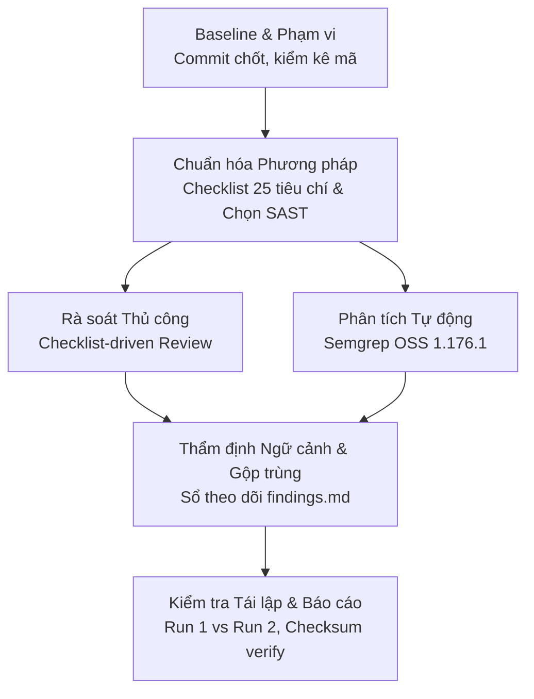

# BÁO CÁO NGHIÊN CỨU HỌC PHẦN AN TOÀN PHẦN MỀM

## Đề tài: Áp dụng Kiểm thử Tĩnh để Đánh giá An toàn Mã nguồn Phân hệ Thủ thư thuộc Hệ thống Quản lý Thư viện PHP

---

### TÓM TẮT NGHIÊN CỨU (EXECUTIVE SUMMARY)

Báo cáo này trình bày kết quả nghiên cứu thực nghiệm áp dụng phương pháp **Kiểm thử tĩnh (Static Testing)** để đánh giá mức độ an toàn của phân hệ thủ thư (`librarian/`) trong mã nguồn ứng dụng quản lý thư viện PHP mã nguồn mở (`Library-Management-System`, commit `082d6fb9bdd7846b57033513791ba5b6d2095c11`).

Nghiên cứu kết hợp hai kỹ thuật bổ trợ: **Rà soát thủ công theo bảng kiểm tra (Checklist-based Manual Code Review)** bao phủ 25 tiêu chí kỹ thuật và nghiệp vụ, kết hợp với **Phân tích tĩnh tự động bằng công cụ so khớp mẫu cây cú pháp trừu tượng (AST-based Automated SAST)** sử dụng Semgrep OSS 1.176.1.

Quá trình phân tích trên toàn bộ 66 tệp PHP tự viết (tổng cộng 2,978 dòng vật lý, 2,551 SLOC) đã ghi nhận:
- **270 cảnh báo thô (raw alerts)** từ công cụ tự động.
- Sau quá trình đối chiếu ngữ cảnh mã nguồn, loại bỏ trùng lặp và phân tích nguyên nhân gốc, nghiên cứu đã xác định và thẩm định **11 nhóm phát hiện kỹ thuật được xác nhận tĩnh (`confirmed-static`)**, trong đó có 2 nhóm lỗi ở mức `CRITICAL` (SQL Injection gây Authentication Bypass tại `login.php`, và Missing Session Verification gây Broken Access Control tại 8 endpoint thay đổi trạng thái), 4 nhóm lỗi ở mức `HIGH` (SQL Injection diện rộng, Stored/Reflected XSS, Lưu mật khẩu dạng bản rõ, Thao tác xóa qua HTTP GET thiếu CSRF token).
- Nghiên cứu ghi nhận **01 trường hợp cảnh báo giả tiêu biểu (`FP-01`)** từ công cụ tự động do gán nhầm dòng dữ liệu từ request vào khóa chính số trong CSDL.
- Phân tích làm rõ **01 nhóm vấn đề nghiệp vụ chưa đủ căn cứ đặc tả (`BIZ-INC-01`)**, tách biệt rõ lỗi kỹ thuật có bằng chứng với giả định nghiệp vụ thiếu đặc tả.
- Quy trình kiểm thử được thực hiện chạy lặp lại độc lập (Run 1 vs Run 2) đạt tính tất định (determinism) tuyệt đối 100% với độ lệch 0% và bảo toàn toàn vẹn mã nguồn baseline.

---

## CHƯƠNG 1: GIỚI THIỆU ĐỀ TÀI VÀ MỤC TIÊU NGHIÊN CỨU

### 1.1. Bối cảnh và Tính cấp thiết
Trong quy trình phát triển phần mềm an toàn (Secure Software Development Life Cycle - S-SDLC), việc phát hiện sớm các lỗ hổng an ninh ngay từ giai đoạn viết mã đóng vai trò sống còn nhằm giảm thiểu chi phí khắc phục và ngăn ngừa sự cố bảo mật khi triển khai vào môi trường sản xuất. Các ứng dụng web xây dựng trên nền tảng PHP cổ điển (legacy PHP procedural) phổ biến trong các cơ quan, trường học thường đối mặt với nguy cơ an ninh cao do sự thiếu vắng cơ chế kiểm tra kiểu dữ liệu, thói quen nối chuỗi câu lệnh SQL và quản lý phiên thiếu tập trung.

Học phần An toàn phần mềm yêu cầu thực hiện một nghiên cứu kiểm thử tĩnh thực nghiệm có phạm vi vừa sức, có phương pháp luận rõ ràng, bằng chứng truy xuất được từ mã nguồn và kết quả phải được thẩm định nghiêm ngặt thay vì chỉ thống kê cảnh báo thô từ máy quét.

### 1.2. Mục tiêu Nghiên cứu
1. Thiết lập một baseline mã nguồn bất biến có thể truy xuất nguồn gốc và kiểm chứng toàn vẹn qua mã băm SHA-256.
2. Xây dựng bảng kiểm tra (checklist) an toàn chuẩn hóa cho ứng dụng web PHP bao phủ toàn diện các rủi ro xác thực, phân quyền, đầu vào/ra, xử lý lỗi và toàn vẹn nghiệp vụ.
3. Khảo sát, lựa chọn và thiết lập công cụ phân tích tĩnh tự động phù hợp với mã nguồn PHP cổ điển chạy hoàn toàn cục bộ (local execution).
4. Thực hiện phân tích tĩnh kết hợp (Hybrid Static Testing) giữa rà soát thủ công và quét tự động; thực hiện thẩm định ngữ cảnh để phân loại rõ ràng: lỗi xác nhận (`confirmed-static`), cảnh báo giả (`false-positive`), và điểm chưa đủ đặc tả (`inconclusive`).
5. Đánh giá tính tái lập (reproducibility) của quy trình phân tích và đề xuất các giải pháp khắc phục có tính khả thi.

### 1.3. Phạm vi Nghiên cứu và Ranh giới An toàn
- **Phạm vi trong khảo sát (In-scope):** Toàn bộ mã nguồn PHP tự viết thuộc phân hệ thủ thư nằm trong thư mục `librarian/` của dự án `Library-Management-System` tại commit chốt `082d6fb9bdd7846b57033513791ba5b6d2095c11`.
- **Phạm vi loại trừ (Out-of-scope):**
  - Thư viện bên thứ ba trong `librarian/vendors/` (CKEditor, DataTables, TinyMCE...).
  - Thư mục bản sao lưu cũ `library/` và tệp nén `library.zip`.
  - Các tệp giao diện cổng độc giả ở thư mục gốc (`about.php`, `contact.php`, `signup.php`...).
  - Tài sản tĩnh giao diện (hình ảnh, CSS, JavaScript client-side) và tài liệu thuyết trình.
- **Ranh giới an toàn (Non-execution Policy):** Nghiên cứu cam kết **tuyệt đối không khởi chạy ứng dụng upstream**, không kết nối CSDL đang chạy, không gửi payload khai thác động qua mạng, và không sửa đổi baseline mã nguồn.

### 1.4. Câu hỏi Nghiên cứu (Research Questions)
- **RQ1:** Các công cụ SAST tự động hiện đại (như Semgrep, PHPStan) thể hiện khả năng phân tích và giới hạn như thế nào khi áp dụng trên mã nguồn PHP 5.x thủ tục cổ điển?
- **RQ2:** Tỷ lệ cảnh báo giả và sự khác biệt giữa cảnh báo thô của công cụ tự động so với kết quả sau khi thẩm định ngữ cảnh thủ công là bao nhiêu?
- **RQ3:** Những mẫu lỗ hổng an toàn nào xuất hiện phổ biến nhất trong phân hệ thủ thư của hệ thống thư viện khảo sát, và nguyên nhân gốc rễ bắt nguồn từ đâu?

---

## CHƯƠNG 2: CƠ SỞ LÝ THUYẾT VỀ KIỂM THỬ TĨNH

### 2.1. Bản chất của Kiểm thử Tĩnh (Static Testing)
Kiểm thử tĩnh là phương pháp đánh giá phần mềm (bao gồm mã nguồn, tệp cấu hình, tài liệu thiết kế) mà **không cần thực thi chương trình**. Khác với kiểm thử động (Dynamic Testing / DAST) đòi hỏi ứng dụng phải ở trạng thái đang chạy và kiểm tra phản hồi từ bên ngoài, kiểm thử tĩnh cho phép kiểm tra trực tiếp cấu trúc bên trong của mã (White-box testing), tìm ra nguyên nhân gốc rễ của lỗi (root cause) trước khi lỗi có cơ hội được biên dịch hoặc thực thi.

Theo tiêu chuẩn ISO/IEC/IEEE 29119 và tài liệu hướng dẫn an toàn NIST SP 800-115, kiểm thử tĩnh bao gồm hai kỹ thuật cốt lõi:
1. **Rà soát thủ công (Manual Code Review / Inspection):** Con người trực tiếp đọc, đối chiếu logic nghiệp vụ, mô hình dữ liệu và các luồng kiểm soát truy cập mà công cụ tự động khó nhận diện.
2. **Phân tích mã tĩnh tự động (Automated Static Application Security Testing - SAST):** Phần mềm tự động phân tích cú pháp mã nguồn theo cây cú pháp trừu tượng (Abstract Syntax Tree - AST) hoặc đồ thị dòng điều khiển (Control Flow Graph - CFG) để tìm các mẫu mã vi phạm quy tắc an toàn.

### 2.2. Phân biệt Rà soát Thủ công và Phân tích Tự động

| Tiêu chí so sánh | Rà soát thủ công (Manual Review) | Phân tích tự động (Automated SAST) |
|---|---|---|
| **Tốc độ và Độ bao phủ** | Chậm, phụ thuộc vào sức người, khó bao quát 100% dòng mã lớn. | Cực nhanh, quét hàng chục nghìn dòng mã trong vài giây. |
| **Nhận thức Ngữ cảnh (Context)** | Rất cao; hiểu rõ ngữ cảnh nghiệp vụ, liên kết logic liên tệp. | Thấp; chủ yếu dựa trên đối sánh mẫu cục bộ hoặc xâu chuỗi dòng dữ liệu định sẵn. |
| **Khả năng phát hiện lỗi Logic** | Xuất sắc đối với lỗi phân quyền (Access Control), quy trình nghiệp vụ. | Rất kém đối với logic nghiệp vụ thiếu đặc tả; hay bỏ sót thiếu sót phiên. |
| **Cảnh báo giả (False Positives)** | Rất thấp (do có chuyên gia thẩm định trực tiếp). | Thường cao (do công cụ không nắm hết ngữ cảnh hoặc các hàm vệ sinh dữ liệu). |
| **Tính tất định & Tái lập** | Có thể chênh lệch giữa các người đánh giá khác nhau. | Tuyệt đối; chạy lặp lại cho ra kết quả đồng nhất với cùng bộ quy tắc. |

### 2.3. Vấn đề Cảnh báo Giả và Giới hạn của Phân tích Tĩnh
Một trong những thách thức lớn nhất của kiểm thử tự động là hiện tượng **Cảnh báo giả (False Positive - FP)** — công cụ báo lỗi nhưng trong thực tế mã nguồn không có lỗ hổng (ví dụ do dữ liệu đã được lọc ở tầng trước, hoặc biến bị gán nhầm là tainted). Ngược lại, hiện tượng **Bỏ sót lỗ hổng (False Negative - FN)** xảy ra khi công cụ không thể theo dõi các luồng gọi động (`eval`, biến hàm, include động).

Ngoài ra, kiểm thử tĩnh bị giới hạn bởi:
- Không đánh giá được các lỗ hổng phát sinh từ cấu hình máy chủ web thực tế (Apache, Nginx).
- Không chứng minh được khả năng khai thác thành công (exploitability) trong điều kiện có tường lửa ứng dụng (WAF) hay cơ chế phòng vệ mạng.

---

## CHƯƠNG 3: ĐỐI TƯỢNG VÀ PHẠM VI KHẢO SÁT

### 3.1. Thông tin Kho lưu trữ và Baseline Khảo sát
- **Kho lưu trữ:** `https://github.com/vinitshahdeo/Library-Management-System`
- **Commit chốt:** `082d6fb9bdd7846b57033513791ba5b6d2095c11` (Commit message: `added social icons`, tác giả Vinit Shahdeo, ngày 12/02/2020).
- **Mã băm toàn vẹn Git Tar Archive SHA-256:** `fabac8fc61e74d2124eeb31a82d73acc8d0234a57ffdd57b54af3184b37293c7`.
- **Mã băm LICENSE SHA-256:** `2e21d291d98be3562c6c122c35e9e624ef31950db4fdfbd95a5aa5b23ce192c0` (bảo toàn nguyên vẹn giấy phép MIT tại `study/source/LICENSE`).
- **Mã băm CSDL Schema SHA-256 (`db/eb_lms.sql`):** `1d2817e54dfc20d81e169e8080a05f4bc805711e8676359ee69f6d67f20ce8d4`.

### 3.2. Cấu trúc Quy mô Mã nguồn Phân hệ Thủ thư
Phân hệ thủ thư (`librarian/`) bao gồm **66 tệp PHP tự viết**, được tổ chức thành 5 nhóm chức năng chính:
- **Xác thực & Người dùng (10 tệp - 379 SLOC):** `index.php`, `login.php`, `logout.php`, `session.php`, `users.php`, `modal_add_user.php`, `modal_edit_user.php`, `delete_user.php`, `delete_user_modal.php`, `navbar_user.php`.
- **Quản lý Sách (17 tệp - 884 SLOC):** `books.php`, `add_books.php`, `books_save.php`, `edit_book.php`, `update_books.php`, `delete_books.php`, `delete_book_modal.php`, `advance_search.php`, `search_form.php`, `archive.php`, `damage.php`, `lost.php`, `new_books.php`, `old_books.php`, `sub_rep.php`, `unreturned_books.php`, `navbar_books.php`.
- **Quản lý Độc giả / Thành viên (15 tệp - 582 SLOC):** `member.php`, `add_member.php`, `member_save.php`, `edit_member.php`, `update_member.php`, `delete_member.php`, `delete_member_modal.php`, `navbar_member.php`, và nhóm tệp bản sao `student` (`add_student.php`, `student_save.php`, `edit_student.php`, `update_students.php`, `delete_student.php`, `delete_student_modal.php`, `unstudents.php`).
- **Mượn – Trả Sách (12 tệp - 513 SLOC):** `borrow.php`, `borrowname.php`, `borrow_save.php`, `return.php`, `returnname.php`, `return_save.php`, `view_borrow.php`, `view_return.php`, `transaction.php`, `modal_return.php`, `navbar_borrow.php`, `navbar_transaction.php`.
- **Giao diện & Dùng chung (12 tệp - 193 SLOC):** `dashboard.php`, `dbcon.php`, `dropdown.php`, `footer.php`, `footer2.php`, `header.php`, `navbar.php`, `navbar2.php`, `navbar_dashboard.php`, `slider.php`, `tooltip.php`, `toolttip_edit_delete.php`.

**Tổng hợp kích thước:** 2,978 dòng vật lý, 399 dòng trắng, 28 dòng chú thích (0.9%), **2,551 dòng mã thực tế (SLOC)**.

### 3.3. Mô hình Thực thể Cơ sở Dữ liệu (`db/eb_lms.sql`)
Cơ sở dữ liệu định nghĩa 8 bảng: `book`, `borrow`, `borrowdetails`, `category`, `member`, `users`, `type`, `lost_book`.
Mã nguồn phân hệ thủ thư truy vấn chủ yếu trên 6 bảng: `book` (16 tệp), `member` (15 tệp), `category` (11 tệp), `borrowdetails` (6 tệp), `users` (6 tệp), `borrow` (5 tệp).
*Điểm bất thường quan sát được:* Tệp `unstudents.php` thực hiện truy vấn `SELECT * FROM students`, nhưng bảng `students` hoàn toàn không tồn tại trong CSDL.

---

## CHƯƠNG 4: PHƯƠNG PHÁP NGHIÊN CỨU VÀ QUY TRÌNH THỰC HIỆN

Nghiên cứu áp dụng quy trình kiểm thử tĩnh 4 bước khép kín:



### 4.1. Khung Bảng kiểm tra An toàn (Checklist Framework)
Nhóm nghiên cứu xây dựng `study/checklist.md` gồm 25 tiêu chí đo kiểm thuộc 7 lĩnh vực trọng yếu:
1. Xác thực và Phiên (AUTH-01 đến AUTH-05)
2. Kiểm soát Truy cập và Phân quyền (AC-01 đến AC-04)
3. Thẩm định Đầu vào và Truy vấn CSDL (INP-01 đến INP-04)
4. Mã hóa Đầu ra và Xử lý Giao diện (OUT-01 đến OUT-03)
5. Bảo vệ Thao tác Đổi trạng thái (STATE-01 đến STATE-03)
6. Xử lý Lỗi và Thông tin Tiết lộ (ERR-01 đến ERR-03)
7. Toàn vẹn Nghiệp vụ và Giao dịch Mượn–Trả (BIZ-01 đến BIZ-05)

### 4.2. Lựa chọn Công cụ và Cấu hình Thực thi
Qua thử nghiệm sơ bộ:
- **PHPStan 2.1.8:** Thất bại do môi trường runtime PHP 8.5 thiếu phần mở rộng `mysql_*`. Khi dùng stubs, PHPStan báo 0 lỗi bảo mật trên `login.php`, bỏ sót hoàn toàn SQLi.
- **Semgrep OSS 1.176.1:** Đạt tỷ lệ phân tích cú pháp AST 100% trên mã PHP 5.x legacy, phát hiện chính xác các luồng dữ liệu độc hại và lỗi bảo mật.
- **Quyết định cấu hình:**
  Sử dụng Semgrep OSS 1.176.1 kết hợp bộ quy tắc cộng đồng (`p/php`, `p/sql-injection`, `p/xss`) và bộ quy tắc tùy biến ngữ cảnh dự án (`study/rules/custom_php_rules.yaml`), loại trừ thư mục `vendors/`.

### 4.3. Quy trình Thẩm định và Xử lý Bằng chứng
Mọi phát hiện đều được đối chiếu chéo giữa kết quả máy quét và mã nguồn thực tế:
- **`confirmed-static`:** Chỉ gán khi đọc mã chứng minh rõ ràng thiếu sót kiểm soát trong ngữ cảnh cụ thể.
- **`false-positive`:** Gán khi cảnh báo của công cụ tự động bị mâu thuẫn với kiểu dữ liệu hoặc logic thực tế.
- **`inconclusive`:** Gán cho các trường hợp thiếu tài liệu đặc tả SRS từ upstream.

---

## CHƯƠNG 5: KẾT QUẢ VÀ PHÂN TÍCH CÁC TRƯỜNG HỢP TIÊU BIỂU

### 5.1. Tổng hợp Kết quả Đo lường và Phát hiện

- **Độ bao phủ phân tích:** 66/66 tệp PHP trong phân hệ (100% tệp mục tiêu).
- **Cảnh báo tự động thô (Raw SAST Alerts):** 270 cảnh báo từ Semgrep.
- **Lỗi tệp từ type checker:** 17 lỗi từ PHPStan (chủ yếu là tệp include không tồn tại).
- **Kết quả sau thẩm định:**
  - **11 phát hiện kỹ thuật được xác nhận (`confirmed-static`)**.
  - **01 cảnh báo giả được phân tích và bác bỏ (`FP-01`)**.
  - **01 nhóm nghiệp vụ thiếu căn cứ đặc tả (`BIZ-INC-01`)**.

### 5.2. Phân tích Các Trường hợp Lỗ hổng Tiêu biểu

#### Trường hợp 1: Authentication Bypass qua SQL Injection tại `login.php` (FIND-01)
- **Vị trí:** `librarian/login.php` dòng 4 - 7.
- **Bằng chứng mã nguồn:**
  ```php
  $username = $_POST['username'];
  $password = $_POST['password'];
  $query = "SELECT * FROM users WHERE username='$username' AND password='$password'";
  $result = mysql_query($query)or die(mysql_error());
  ```
- **Phân tích kỹ thuật:** Câu truy vấn ghép trực tiếp hai chuỗi ký tự `$username` và `$password`. Kẻ tấn công có thể nhập giá trị `admin' -- ` vào trường username. Khi đó câu lệnh SQL trở thành:
  `SELECT * FROM users WHERE username='admin' -- ' AND password='...'`
  Toàn bộ phần kiểm tra mật khẩu bị bỏ qua (commented out), và hệ thống cấp quyền đăng nhập cho tài khoản quản trị viên đầu tiên tìm thấy.
- **Mức độ:** `CRITICAL` (CWE-89).

#### Trường hợp 2: Broken Access Control tại các Endpoint Hành động Trực tiếp (FIND-02)
- **Vị trí:** `delete_user.php`, `delete_books.php`, `delete_member.php`, `books_save.php`, `borrow_save.php`, `member_save.php`, `return_save.php`, `update_books.php`.
- **Bằng chứng mã nguồn (`delete_user.php:1-8`):**
  ```php
  <?php
  include('dbcon.php');
  $id=$_GET['id'];
  mysql_query("delete from users where user_id='$id'") or die(mysql_error());
  header('location:users.php');
  ?>
  ```
- **Phân tích kỹ thuật:** Tác giả ứng dụng chỉ đặt `include('session.php')` tại các trang giao diện trực quan (`users.php`, `dashboard.php`), nhưng hoàn toàn bỏ quên kiểm tra phiên tại các trang xử lý hành động. Bất kỳ người dùng nào không cần đăng nhập chỉ cần gửi một HTTP GET request tới `librarian/delete_user.php?id=X` là có thể xóa tài khoản của thủ thư.
- **Mức độ:** `CRITICAL` (CWE-306, CWE-284).

#### Trường hợp 3: Lưu trữ và Hiển thị Mật khẩu Dạng Bản rõ (FIND-05)
- **Vị trí:** `modal_edit_user.php:18`, `unstudents.php:17,34`, `login.php:6`.
- **Bằng chứng mã nguồn:**
  ```php
  <input type="text" name="password" id="inputPassword" value="<?php echo $row['password']; ?>" required>
  ```
- **Phân tích kỹ thuật:** Mật khẩu trong bảng `users` được lưu ở dạng plaintext. Đặc biệt, trong modal chỉnh sửa thông tin người dùng, mật khẩu hiện tại được in trực tiếp vào thuộc tính `value` của thẻ HTML dạng text mở, cho phép bất kỳ ai đứng gần màn hình hoặc xem mã nguồn trang có thể đọc được mật khẩu.
- **Mức độ:** `HIGH` (CWE-256, CWE-312).

#### Trường hợp 4: Race Condition và Thiếu Transaction trong Mượn Sách (FIND-07)
- **Vị trí:** `borrow_save.php:16-25`.
- **Bằng chứng mã nguồn:**
  ```php
  mysql_query("insert into borrow (member_id,date_borrow,due_date) values ('$member_id',NOW(),'$due_date')")or die(mysql_error());
  $query = mysql_query("select * from borrow order by borrow_id DESC")or die(mysql_error());
  $row = mysql_fetch_array($query);
  $borrow_id = $row['borrow_id'];
  ```
- **Phân tích kỹ thuật:** Thay vì sử dụng hàm `mysql_insert_id()` lấy ID vừa tạo của chính kết nối hiện tại, mã nguồn thực hiện câu lệnh SELECT tìm bản ghi có `borrow_id` lớn nhất. Trong môi trường đồng thời (concurrent requests), nếu hai thủ thư cùng bấm nút cho mượn sách tại cùng một thời điểm, thủ thư A có thể lấy nhầm `borrow_id` của phiếu mượn do thủ thư B vừa tạo.
- **Mức độ:** `MEDIUM` (CWE-362).

### 5.3. Phân tích Trường hợp Cảnh báo Giả Tiêu biểu (False Positive Analysis)
- **Trường hợp FP-01:** Semgrep cảnh báo rule `php.lang.security.injection.echoed-request.echoed-request` tại `advance_search.php:76` (`<tr class="del<?php echo $id ?>">`).
- **Nguyên nhân công cụ báo động:** Ở đầu tệp có nhận `$_POST['title']`. Công cụ tự động suy đoán biến `$id` in ra ở dòng 76 là dữ liệu phản hồi (reflected) từ request.
- **Thực tế đọc mã:** `$id` được lấy từ `$row['book_id']` — một trường khóa chính số tự tăng trong CSDL, không phải là dữ liệu do người dùng truyền vào trong request. Do đó, đây là cảnh báo giả đối với kiểu lỗi Reflected XSS.

---

## CHƯƠNG 6: THẢO LUẬN, ĐỀ XUẤT KHẮC PHỤC VÀ KẾT LUẬN

### 6.1. Thảo luận về Điểm mạnh và Điểm yếu của Hai Phương pháp
- **Công cụ SAST tự động:** Rất xuất sắc trong việc quét rà soát diện rộng, phát hiện nhanh chóng các mẫu cú pháp nguy hiểm lặp đi lặp lại như việc sử dụng thư viện cũ `mysql_*` (147 cảnh báo) hay nối chuỗi biến vào câu lệnh truy vấn (80 cảnh báo). Tuy nhiên, công cụ không thể hiểu được mối quan hệ phân quyền giữa trang hiển thị và trang xử lý hành động (hoàn toàn không cảnh báo về việc thiếu `session.php` tại `delete_user.php`).
- **Rà soát thủ công:** Là phương pháp duy nhất phát hiện được các lỗi nghiêm trọng về kiểm soát truy cập (Broken Access Control), lỗi logic nghiệp vụ đồng thời (Race condition trong `borrow_save.php`), và liên kết tệp gãy.
- **Kết luận phương pháp luận:** Phương pháp tiếp cận kết hợp (Hybrid Approach) là bắt buộc trong kiểm thử an toàn phần mềm. Không thể chỉ dựa vào công cụ tự động để kết luận một ứng dụng an toàn.

### 6.2. Đề xuất Kiến trúc Khắc phục Toàn diện (Systematic Remediation)
Nhóm nghiên cứu khuyến nghị kế hoạch tái cấu trúc an toàn gồm 4 bước:
1. **Khắc phục Khẩn cấp Kiểm soát Truy cập (P0):**
   Bổ sung ngay `require_once('session.php');` tại dòng đầu tiên của tất cả 8 endpoint xử lý hành động (`delete_*.php`, `*_save.php`, `update_*.php`).
2. **Hiện đại hóa Tầng Cơ sở Dữ liệu (P1):**
   Thay thế toàn bộ thư viện `ext/mysql` lỗi thời bằng PDO (PHP Data Objects). Chuyển 100% các câu truy vấn sang cơ chế Prepared Statements với tham số ràng buộc (Bound Parameters) để triệt tiêu hoàn toàn nguy cơ SQL Injection.
3. **Mã hóa Dữ liệu Đầu ra và Chống CSRF (P2):**
   - Tạo hàm trợ giúp xuất dữ liệu an toàn `e($data)` bọc `htmlspecialchars($data, ENT_QUOTES, 'UTF-8')` trên toàn bộ các vị trí in dữ liệu ra HTML.
   - Bổ sung cơ chế sinh và kiểm tra Anti-CSRF token cho mọi thao tác gửi form POST, đồng thời chuyển các thao tác xóa từ GET sang POST.
4. **Bảo vệ Dữ liệu Nhạy cảm và Quản lý Lỗi (P3):**
   - Áp dụng thuật toán băm mật khẩu `password_hash()` với chuẩn Bcrypt/Argon2.
   - Loại bỏ hoàn toàn cú pháp `or die(mysql_error())`; thiết lập trang thông báo lỗi chung và ghi log chi tiết vào tệp tin bảo mật của máy chủ.

### 6.3. Giới hạn của Nghiên cứu
- Nghiên cứu chỉ đánh giá trên commit chốt của một phân hệ thủ thư, không đại diện cho toàn bộ các hệ thống thư viện khác.
- Nghiên cứu tuân thủ nguyên tắc phi thực thi, không tạo mã khai thác thực tế (no exploit development).
- Các nhận định nghiệp vụ mượn sách được xếp vào nhóm `inconclusive` do hạn chế về tài liệu đặc tả từ dự án gốc.

### 6.4. Kết luận
Kiểm thử tĩnh là một công cụ mạnh mẽ và chi phí thấp giúp phát hiện sớm các khiếm khuyết an ninh trong mã nguồn. Nghiên cứu đã chứng minh rằng một ứng dụng trông có vẻ hoạt động bình thường trên giao diện có thể ẩn chứa những lỗ hổng thảm họa (Authentication Bypass, Unauthenticated Deletion) nếu thiếu đi các thực hành lập trình an toàn cơ bản. Việc kết hợp chặt chẽ giữa công cụ tự động và rà soát thủ công có thẩm định là con đường đúng đắn duy nhất để bảo đảm độ tin cậy của các phát hiện an toàn phần mềm.

---

## CHƯƠNG 7: TÀI LIỆU THAM KHẢO VÀ PHỤ LỤC TÁI LẬP

### 7.1. Tài liệu Tham khảo (References)
1. **OWASP Foundation (2021).** *OWASP Top 10:2021 - The Ten Most Critical Web Application Security Risks*. `https://owasp.org/Top10/`
2. **MITRE Corporation (2024).** *Common Weakness Enumeration (CWE) Specification: CWE-89 (SQL Injection), CWE-79 (Cross-Site Scripting), CWE-306 (Missing Authentication), CWE-352 (CSRF), CWE-362 (Race Condition)*. `https://cwe.mitre.org/`
3. **The PHP Group (2024).** *PHP Manual: Deprecation and Removal of ext/mysql*. `https://www.php.net/manual/en/function.mysql-query.php`
4. **Semgrep Inc. (2024).** *Semgrep OSS Documentation & Rules Registry*. `https://semgrep.dev/docs/`
5. **PHPStan Project (2024).** *PHPStan - PHP Static Analysis Tool Documentation*. `https://phpstan.org/user-guide/getting-started`
6. **NIST (2018).** *Special Publication 800-115: Technical Guide to Information Security Testing and Assessment*. National Institute of Standards and Technology.

---

### 7.2. Phụ lục Hướng dẫn Tái lập Kết quả Nghiên cứu (Reproducibility Protocol)

Để tái lập chính xác 100% kết quả của nghiên cứu này, thực hiện theo các bước sau:

1. **Lấy bản sao mã nguồn đúng commit:**
   ```bash
   git clone https://github.com/vinitshahdeo/Library-Management-System.git
   cd Library-Management-System
   git checkout 082d6fb9bdd7846b57033513791ba5b6d2095c11
   ```
2. **Kiểm tra mã băm toàn vẹn:**
   ```bash
   shasum -a 256 LICENSE db/eb_lms.sql
   # Kết quả mong đợi:
   # 2e21d291d98be3562c6c122c35e9e624ef31950db4fdfbd95a5aa5b23ce192c0  LICENSE
   # 1d2817e54dfc20d81e169e8080a05f4bc805711e8676359ee69f6d67f20ce8d4  db/eb_lms.sql
   ```
3. **Cài đặt Semgrep OSS và cấu hình quét:**
   ```bash
   pip install semgrep==1.176.1
   semgrep scan      --config "p/php"      --config "p/sql-injection"      --config "p/xss"      --config study/rules/custom_php_rules.yaml      --exclude 'vendors'      librarian/      --json --output semgrep_output.json
   ```
4. **Kiểm tra số lượng cảnh báo:**
   Tổng số phát hiện trong `semgrep_output.json` phải đạt chính xác **270 cảnh báo**.
