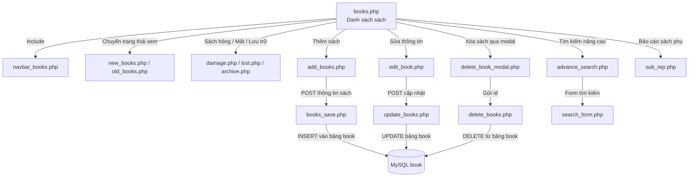
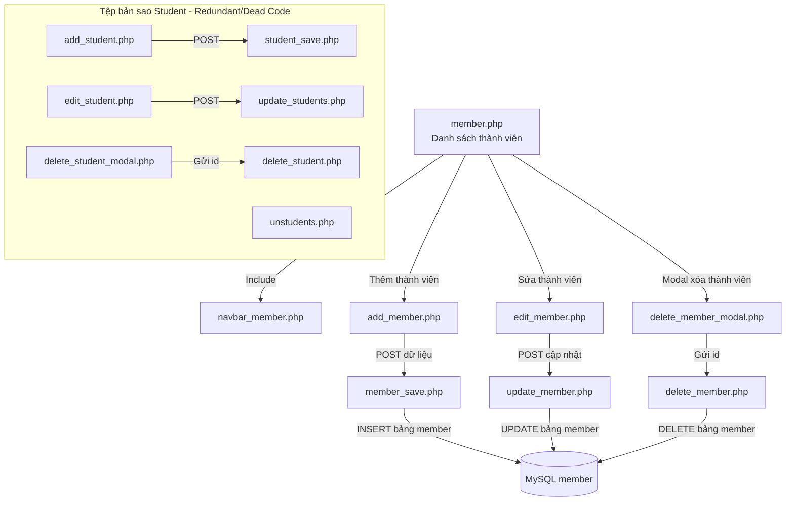
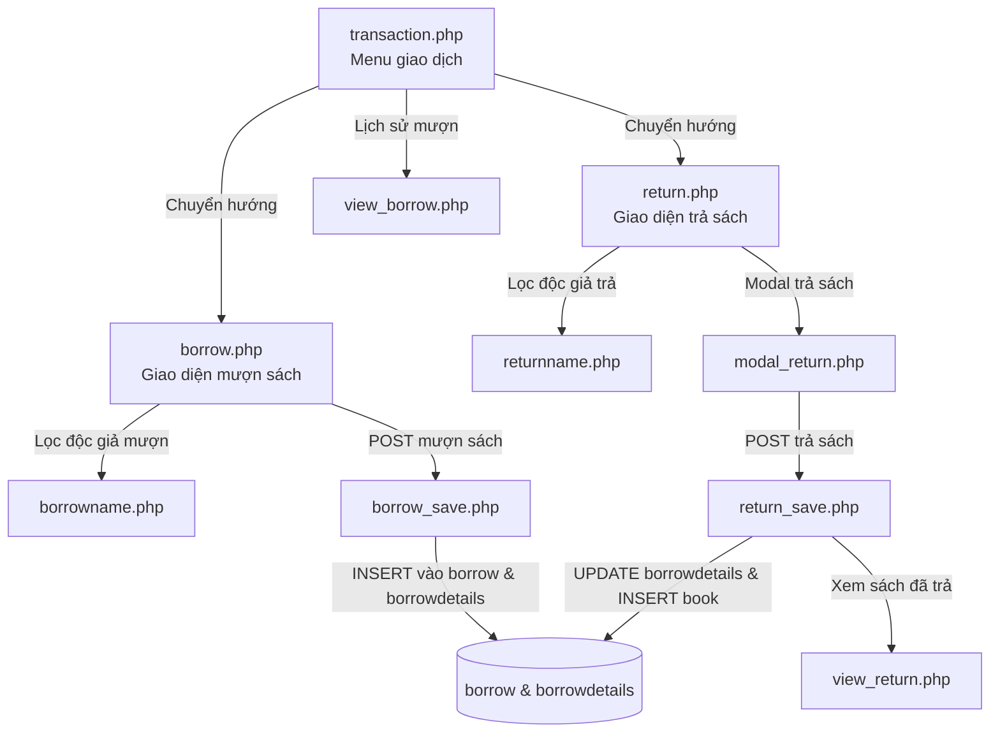

# Phạm vi Khảo sát và Sơ đồ Phân hệ Thủ thư (Librarian Subsystem)

## 1. Tổng quan và Phương pháp Đo đạc Mã nguồn

- **Đối tượng khảo sát:** Toàn bộ mã nguồn PHP do tác giả tự viết thuộc phân hệ thủ thư, đặt tại thư mục `librarian/` của dự án `Library-Management-System` (commit `082d6fb9bdd7846b57033513791ba5b6d2095c11`).
- **Tổng số tệp trong phạm vi chính:** **66 tệp PHP**.
- **Phương pháp đo số dòng (LOC/SLOC):**
  - Sử dụng kịch bản phân tích tĩnh Python quét từng dòng theo chuẩn POSIX:
    - **Tổng số dòng vật lý (Lines):** Tổng số dòng văn bản bao gồm cả ký tự xuống dòng (`splitlines()`).
    - **Dòng trắng (Blank):** Các dòng không chứa ký tự hoặc chỉ chứa khoảng trắng (whitespace).
    - **Dòng chú thích (Comment):** Các dòng chú thích đơn (`//`, `#`) hoặc khối chú thích đa dòng (`/* ... */`).
    - **Dòng mã thực tế (SLOC - Source Lines of Code):** Các dòng chứa cú pháp PHP hoặc mã nhúng HTML thực thi, không phải dòng trắng hay chú thích.
- **Tổng hợp số đo quy mô phân hệ:**
  - **Tổng số dòng vật lý (Total Lines):** `2,978` dòng.
  - **Dòng trắng (Blank Lines):** `399` dòng (chiếm 13.4%).
  - **Dòng chú thích (Comments):** `28` dòng (chiếm 0.9% - mã nguồn có tỷ lệ chú thích cực kỳ thấp).
  - **Dòng mã nguồn thực tế (SLOC):** `2,551` dòng (chiếm 85.7%).

### Thống kê theo Nhóm chức năng

| Nhóm chức năng | Số lượng tệp | Tổng dòng | Dòng trắng | Chú thích | Dòng mã (SLOC) |
|---|:---:|:---:|:---:|:---:|:---:|
| **Xác thực & Người dùng (Auth & Users)** | 10 | 448 | 65 | 4 | 379 |
| **Quản lý sách (Book Management)** | 17 | 1,023 | 129 | 10 | 884 |
| **Quản lý thành viên (Member/Student)** | 15 | 681 | 96 | 3 | 582 |
| **Mượn – Trả sách (Borrow & Return)** | 12 | 599 | 77 | 9 | 513 |
| **Giao diện & Dùng chung (Layout & Support)** | 12 | 227 | 32 | 2 | 193 |
| **TỔNG CỘNG** | **66** | **2,978** | **399** | **28** | **2,551** |

---

## 2. Danh mục Loại trừ và Lý do Loại trừ

Để đảm bảo kết quả đánh giá phản ánh chính xác chất lượng mã nguồn của phân hệ thủ thư mà không bị sai lệch bởi thư viện bên thứ ba hoặc các bản sao mã, các thành phần sau được loại trừ khỏi phạm vi phân tích an toàn chính:

1. **Thư viện bên thứ ba (`study/source/librarian/vendors/`):**
   - Bao gồm các thư viện giao diện và công cụ web: CKEditor, DataTables, TinyMCE, jGrowl, FullCalendar, WYSIWYG, Morris, Wizard, Flot, EasyPieChart, Bootstrap-WYSIWYG.
   - Chứa 18 tệp PHP mẫu (`posteddata.php`, `sample_posteddata.php`, các tệp unit test template của DataTables trong `vendors/datatables/unit_testing/`).
   - *Lý do loại trừ:* Đây là mã nguồn phân phối từ các dự án mở thứ ba, không do tác giả ứng dụng viết, nếu quét chung sẽ gây nhiễu số lượng cảnh báo không thuộc trách nhiệm của phân hệ.
2. **Thư mục bản sao trùng lặp (`study/source/library/`):**
   - Thư mục này là bản sao cũ (duplicate/legacy snapshot) của hệ thống trong upstream repo.
   - *Lý do loại trừ:* Tránh đếm lặp hai lần cùng một lỗi mã nguồn; nghiên cứu chỉ tập trung vào phiên bản chính thống trong `librarian/`.
3. **Tệp nén lưu trữ (`study/source/library.zip`):**
   - Tệp nén nhị phân dung lượng ~22.8 MB chứa mã nguồn cũ.
   - *Lý do loại trừ:* Tệp lưu trữ tĩnh nhị phân, không chạy trực tiếp.
4. **Các trang giao diện độc giả ở thư mục gốc (`study/source/*.php`):**
   - Gồm 25 tệp PHP ở thư mục gốc (`about.php`, `contact.php`, `index.php`, `signup.php`, `signup_form.php`, `login.php`, `session.php`, `slider.php`, ...).
   - *Lý do loại trừ:* Thuộc phân hệ độc giả/công cộng (public portal), tách biệt với phân hệ thủ thư quản trị nội bộ (`librarian/`).
5. **Tài sản tĩnh và phương tiện (`bootstrap/`, `assets/`, `upload/`, `media/`, `css/`, `js/`, `font/`):**
   - Các tệp hình ảnh, stylesheet CSS, script JavaScript phía client, tệp font chữ TTF.
   - *Lý do loại trừ:* Không chứa logic nghiệp vụ PHP phía server.
6. **Tài liệu dự án upstream (`PROJECT REPORT/`, `PPTs/`, `screenshots/`, `README.md`):**
   - Tài liệu thuyết trình, báo cáo tham khảo cũ và ảnh chụp màn hình của tác giả upstream.

---

## 3. Danh mục Kiểm kê Chi tiết 66 Tệp PHP trong `librarian/`

| Tệp mã nguồn | Nhóm chức năng | Tổng dòng | Trắng | Chú thích | SLOC | SHA-256 (rút gọn) |
|---|---|:---:|:---:|:---:|:---:|---|
| `add_books.php` | Quản lý sách | 109 | 15 | 0 | 94 | `743d6c0838e9...` |
| `add_member.php` | Quản lý thành viên/độc giả | 98 | 16 | 0 | 82 | `33ea82bd44f4...` |
| `add_student.php` | Quản lý thành viên/độc giả | 93 | 16 | 0 | 77 | `6b747154ceb0...` |
| `advance_search.php` | Quản lý sách | 107 | 13 | 3 | 91 | `9f226e067145...` |
| `archive.php` | Quản lý sách | 68 | 9 | 0 | 59 | `ea1a16af80c5...` |
| `books.php` | Quản lý sách | 105 | 14 | 2 | 89 | `db1c40249d12...` |
| `books_save.php` | Quản lý sách | 26 | 7 | 2 | 17 | `f5cb1841cd37...` |
| `borrow.php` | Mượn – Trả sách | 110 | 17 | 0 | 93 | `5419e91ef8f0...` |
| `borrow_save.php` | Mượn – Trả sách | 36 | 15 | 0 | 21 | `9b863d372f91...` |
| `borrowname.php` | Mượn – Trả sách | 27 | 0 | 0 | 27 | `0cab07c842f5...` |
| `damage.php` | Quản lý sách | 90 | 9 | 0 | 81 | `06828eda80ba...` |
| `dashboard.php` | Giao diện & Dùng chung | 16 | 3 | 0 | 13 | `1b47d082e08b...` |
| `dbcon.php` | Giao diện & Dùng chung | 3 | 0 | 0 | 3 | `563f15ea261a...` |
| `delete_book_modal.php` | Quản lý sách | 11 | 2 | 0 | 9 | `7fe14e5db5c0...` |
| `delete_books.php` | Quản lý sách | 6 | 0 | 0 | 6 | `4e3c391fcabf...` |
| `delete_member.php` | Quản lý thành viên/độc giả | 6 | 0 | 0 | 6 | `e9bc8257d347...` |
| `delete_member_modal.php` | Quản lý thành viên/độc giả | 11 | 2 | 0 | 9 | `0283758eb341...` |
| `delete_student.php` | Quản lý thành viên/độc giả | 6 | 0 | 0 | 6 | `e9bc8257d347...` |
| `delete_student_modal.php` | Quản lý thành viên/độc giả | 11 | 2 | 0 | 9 | `a74831810e37...` |
| `delete_user.php` | Xác thực & Người dùng | 9 | 3 | 0 | 6 | `4a18bea61ce3...` |
| `delete_user_modal.php` | Xác thực & Người dùng | 11 | 2 | 0 | 9 | `ff48bbfa5add...` |
| `dropdown.php` | Giao diện & Dùng chung | 8 | 0 | 0 | 8 | `d7b37800e36f...` |
| `edit_book.php` | Quản lý sách | 104 | 5 | 0 | 99 | `ea5d1ede2341...` |
| `edit_member.php` | Quản lý thành viên/độc giả | 108 | 15 | 0 | 93 | `0805160c96e7...` |
| `edit_student.php` | Quản lý thành viên/độc giả | 107 | 17 | 0 | 90 | `2fae42959e0f...` |
| `footer.php` | Giao diện & Dùng chung | 33 | 4 | 0 | 29 | `3c0820eae472...` |
| `footer2.php` | Giao diện & Dùng chung | 16 | 2 | 0 | 14 | `a53d7ed578ab...` |
| `header.php` | Giao diện & Dùng chung | 58 | 6 | 0 | 52 | `7acd6a67faa0...` |
| `index.php` | Xác thực & Người dùng | 58 | 2 | 0 | 56 | `d77d002d64c0...` |
| `login.php` | Xác thực & Người dùng | 18 | 0 | 0 | 18 | `f2c6b2190d5c...` |
| `logout.php` | Xác thực & Người dùng | 5 | 0 | 0 | 5 | `3355c3814a67...` |
| `lost.php` | Quản lý sách | 90 | 9 | 0 | 81 | `87f1e7b24c1a...` |
| `member.php` | Quản lý thành viên/độc giả | 65 | 10 | 0 | 55 | `ad0d412e73a0...` |
| `member_save.php` | Quản lý thành viên/độc giả | 20 | 6 | 0 | 14 | `155447af3729...` |
| `modal_add_user.php` | Xác thực & Người dùng | 50 | 2 | 0 | 48 | `5f28f1a315a9...` |
| `modal_edit_user.php` | Xác thực & Người dùng | 59 | 5 | 0 | 54 | `8d4a95d37819...` |
| `modal_return.php` | Mượn – Trả sách | 11 | 2 | 0 | 9 | `2ef8eed12431...` |
| `navbar.php` | Giao diện & Dùng chung | 24 | 8 | 0 | 16 | `901c25037b6e...` |
| `navbar2.php` | Giao diện & Dùng chung | 28 | 10 | 0 | 18 | `5c47c96c112e...` |
| `navbar_books.php` | Quản lý sách | 33 | 3 | 0 | 30 | `d6e28dac38a8...` |
| `navbar_borrow.php` | Mượn – Trả sách | 33 | 3 | 0 | 30 | `623db4f4a296...` |
| `navbar_dashboard.php` | Giao diện & Dùng chung | 33 | 3 | 0 | 30 | `16cd88a31566...` |
| `navbar_member.php` | Quản lý thành viên/độc giả | 33 | 3 | 0 | 30 | `e75715bec4a8...` |
| `navbar_transaction.php` | Mượn – Trả sách | 45 | 2 | 0 | 43 | `a972bbf1a4d7...` |
| `navbar_user.php` | Xác thực & Người dùng | 33 | 3 | 0 | 30 | `ca8a5efd3351...` |
| `new_books.php` | Quản lý sách | 90 | 9 | 0 | 81 | `2cb7d15a9216...` |
| `old_books.php` | Quản lý sách | 90 | 9 | 0 | 81 | `e216a02cf1dc...` |
| `return.php` | Mượn – Trả sách | 75 | 12 | 0 | 63 | `90cb80fc5d34...` |
| `return_save.php` | Mượn – Trả sách | 10 | 3 | 0 | 7 | `f4e5e2867c38...` |
| `returnname.php` | Mượn – Trả sách | 26 | 0 | 0 | 26 | `52f1d8be01d4...` |
| `search_form.php` | Quản lý sách | 29 | 1 | 0 | 28 | `f93bcab9c982...` |
| `session.php` | Xác thực & Người dùng | 10 | 0 | 2 | 8 | `e5130298aaca...` |
| `slider.php` | Giao diện & Dùng chung | 51 | 19 | 0 | 32 | `a1fc3507ffa0...` |
| `student_save.php` | Quản lý thành viên/độc giả | 20 | 6 | 0 | 14 | `155447af3729...` |
| `sub_rep.php` | Quản lý sách | 90 | 9 | 0 | 81 | `d32eb8d8a9fa...` |
| `tooltip.php` | Giao diện & Dùng chung | 45 | 3 | 0 | 42 | `cffe91e41846...` |
| `toolttip_edit_delete.php` | Giao diện & Dùng chung | 26 | 2 | 0 | 24 | `a5f68323e4b7...` |
| `transaction.php` | Mượn – Trả sách | 18 | 5 | 0 | 13 | `ec939165e10b...` |
| `unreturned_books.php` | Quản lý sách | 0 | 0 | 0 | 0 | `e3b0c44298fc...` |
| `unstudents.php` | Quản lý thành viên/độc giả | 58 | 6 | 0 | 52 | `e898cfb016ff...` |
| `update_books.php` | Quản lý sách | 26 | 6 | 2 | 18 | `8331aa101ba2...` |
| `update_member.php` | Quản lý thành viên/độc giả | 19 | 3 | 0 | 16 | `b62c798c15be...` |
| `update_students.php` | Quản lý thành viên/độc giả | 20 | 5 | 0 | 15 | `0d99decb2462...` |
| `users.php` | Xác thực & Người dùng | 92 | 12 | 17 | 63 | `ec5c07b38340...` |
| `view_borrow.php` | Mượn – Trả sách | 76 | 12 | 0 | 64 | `2321bab71cbb...` |
| `view_return.php` | Mượn – Trả sách | 76 | 12 | 0 | 64 | `4b871ac67c37...` |

---

## 4. Sơ đồ Luồng Xử lý, Include và Quan hệ Giữa Các Tệp

### 4.1. Nhóm 1: Xác thực, Phiên và Người dùng Thủ thư (Auth & Users)

```mermaid
graph TD
    A[index.php<br>Trang đăng nhập] -->|Gửi POST username/password| B[login.php<br>Xử lý xác thực]
    B -->|SELECT từ bảng users| DB[(MySQL users)]
    B -->|Thành công: ghi session| C[dashboard.php<br>Bảng điều khiển]
    C -->|Kiểm tra session| S[session.php<br>Kiểm tra $_SESSION['id']]
    C -->|Thoát| L[logout.php<br>session_destroy]
    
    C -->|Quản trị tài khoản| U[users.php<br>Danh sách thủ thư]
    U -->|Include modal thêm| MAU[modal_add_user.php]
    MAU -->|POST thêm user| U
    U -->|Include modal sửa| MEU[modal_edit_user.php]
    MEU -->|POST cập nhật user| U
    U -->|Include modal xóa| MDU[delete_user_modal.php]
    MDU -->|GET id để xóa| DU[delete_user.php]
    DU -->|DELETE từ bảng users| DB
```

- **Các điểm đáng lưu ý:**
  - `login.php`: Truy vấn trực tiếp `users` với giá trị `$username` và `$password` từ `$_POST` không qua chuẩn hóa/tham số hóa.
  - `delete_user.php`: Nhận `$id = $_POST['id']` (hoặc GET qua form modal) và thực thi `DELETE FROM users WHERE user_id='$id'` nhưng **không hề include `session.php`**, cho phép bất kỳ ai gửi request để xóa tài khoản thủ thư mà không cần đăng nhập.

### 4.2. Nhóm 2: Quản lý Sách (Book Management)



- **Các điểm đáng lưu ý:**
  - `books_save.php`, `delete_books.php`: Đều **không include `session.php`**, không xác thực phiên đăng nhập trước khi thêm/xóa sách.
  - `archive.php`: Cố gắng `include('navbar_archive.php')` nhưng tệp này **không tồn tại** trong mã nguồn.
  - `unreturned_books.php`: Tệp có kích thước **0 bytes (rỗng)**, hoàn toàn không có nội dung.

### 4.3. Nhóm 3: Quản lý Thành viên và Độc giả (Member & Student)



- **Các điểm đáng lưu ý:**
  - **Mã nguồn trùng lặp 100%:** `delete_member.php` và `delete_student.php` có mã băm SHA-256 giống hệt nhau (`e9bc8257d347...`); `member_save.php` và `student_save.php` có mã băm SHA-256 giống hệt nhau (`155447af3729...`). Cả hai đều thao tác trên cùng bảng `member`.
  - `add_student.php` liên kết nút quay lại tới `students.php` - tệp **không tồn tại** trong `librarian/`.
  - `unstudents.php`: Include `navbar_dasboard.php` (sai chính tả của `navbar_dashboard.php`) và `confirm_request.php` (không tồn tại), đồng thời thực hiện truy vấn `SELECT * FROM students` - bảng **không tồn tại** trong cơ sở dữ liệu `eb_lms.sql`.
  - `member_save.php`, `student_save.php`, `delete_member.php`, `delete_student.php`: Đều **không include `session.php`**.

### 4.4. Nhóm 4: Mượn – Trả Sách (Borrow & Return Transactions)



- **Các điểm đáng lưu ý:**
  - `borrow_save.php`: Nhận danh sách `selector` (mảng ID sách) và `member_id` từ `$_POST`, thực hiện vòng lặp `INSERT INTO borrow` và `INSERT INTO borrowdetails`. Tệp này **không include `session.php`**, không kiểm tra quyền, không kiểm tra số lượng sách còn trong kho hoặc giới hạn mượn.
  - `return_save.php`: Nhận `$id_get` và mảng `id` sách, cập nhật `borrow_status = 'returned'`, `date_return = NOW()`. Tệp này cũng **không include `session.php`**.

---

## 5. Bảng Đối chiếu Thực thể Cơ sở Dữ liệu (`db/eb_lms.sql`)

Dựa trên việc đọc và phân tích tĩnh tệp định nghĩa cơ sở dữ liệu `study/source/db/eb_lms.sql`, hệ thống thiết kế 8 bảng. Bảng dưới đây thể hiện mức độ liên kết giữa mã nguồn phân hệ thủ thư với các bảng này:

| Tên bảng trong SQL | Khóa chính / Cột quan trọng | Mục đích thiết kế | Các tệp trong `librarian/` truy vấn |
|---|---|---|---|
| `book` | `book_id`, `book_title`, `category_id`, `author`, `book_copies`, `status` | Lưu thông tin danh mục sách và số lượng bản sao | `advance_search.php`, `archive.php`, `books.php`, `books_save.php`, `borrow.php`, `borrow_save.php`, `damage.php`, `delete_books.php`, `edit_book.php`, `lost.php`, `new_books.php`, `old_books.php`, `return_save.php`, `sub_rep.php`, `update_books.php`, `view_borrow.php` (16 tệp) |
| `borrow` | `borrow_id`, `member_id`, `date_borrow`, `due_date` | Lưu phiên mượn của thành viên | `borrow_save.php`, `return.php`, `return_save.php`, `view_borrow.php`, `view_return.php` (5 tệp) |
| `borrowdetails` | `borrow_details_id`, `book_id`, `borrow_id`, `borrow_status`, `date_return` | Chi tiết từng cuốn sách trong phiên mượn và trạng thái trả | `advance_search.php`, `books.php`, `return.php`, `return_save.php`, `view_borrow.php`, `view_return.php` (6 tệp) |
| `category` | `category_id`, `classname` | Phân loại thể loại sách | `add_books.php`, `advance_search.php`, `archive.php`, `books.php`, `borrow.php`, `damage.php`, `edit_book.php`, `lost.php`, `new_books.php`, `old_books.php`, `sub_rep.php` (11 tệp) |
| `member` | `member_id`, `firstname`, `lastname`, `gender`, `address`, `contact`, `type_id`, `year_level`, `status` | Lưu thông tin độc giả (sinh viên, giảng viên) | `borrow.php`, `borrowname.php`, `delete_member.php`, `delete_student.php`, `edit_member.php`, `edit_student.php`, `member.php`, `member_save.php`, `return.php`, `returnname.php`, `student_save.php`, `update_member.php`, `update_students.php`, `view_borrow.php`, `view_return.php` (15 tệp) |
| `users` | `user_id`, `username`, `password`, `firstname`, `lastname` | Tài khoản thủ thư quản trị hệ thống | `delete_user.php`, `index.php`, `login.php`, `modal_add_user.php`, `modal_edit_user.php`, `users.php` (6 tệp) |
| `type` | `type_id`, `borrowertype` | Loại độc giả (Student, Teacher...) | Chỉ được tham chiếu gián tiếp qua `type_id` trong bảng `member`; không có truy vấn `JOIN type` rõ ràng trong `librarian/`. |
| `lost_book` | `Book_ID`, `Title`, `Author`, `Price` | Lưu sách bị mất | Không được sử dụng trực tiếp trong `librarian/` (thay vào đó `lost.php` truy vấn bảng `book` với điều kiện `status = 'Lost'`). |
| *(Bảng `students`)* | *(Không tồn tại trong `eb_lms.sql`)* | *(Giả định bảng sinh viên riêng)* | Bị truy vấn bởi duy nhất tệp rác `unstudents.php` (`SELECT * FROM students`). |

---

## 6. Các Phụ thuộc Hỗ trợ và Điểm Dị thường / Chưa rõ

Qua rà soát tĩnh cấu trúc mã nguồn và quan hệ include, nhóm nghiên cứu phát hiện các vấn đề kỹ thuật và điểm chưa rõ sau:

1. **Phụ thuộc lỗi thời vào phần mở rộng `mysql_*` trong `dbcon.php`:**
   - `dbcon.php` sử dụng hàm `mysql_connect('localhost', 'root', '')` và `mysql_select_db('eb_lms')`.
   - Các hàm này đã bị khai tử (deprecated từ PHP 5.5 và bị xóa hoàn toàn từ PHP 7.0). Mã nguồn chỉ tương thích với PHP <= 5.6 cũ.
2. **Thiếu vắng cơ chế kiểm soát phiên (Session Check) tại các Endpoint xử lý trực tiếp:**
   - Trong khi các trang hiển thị giao diện (`dashboard.php`, `books.php`, `member.php`...) có `include('session.php')`, hầu hết các tệp xử lý dữ liệu và thay đổi trạng thái lại **bỏ quên `session.php`**:
     - Thao tác xóa: `delete_books.php`, `delete_member.php`, `delete_student.php`, `delete_user.php`.
     - Thao tác ghi: `books_save.php`, `borrow_save.php`, `member_save.php`, `student_save.php`.
   - Điều này dẫn đến nguy cơ Broken Access Control nghiêm trọng: kẻ tấn công chỉ cần gửi HTTP POST/GET trực tiếp đến các tệp này để thực hiện thao tác mà không cần có phiên đăng nhập hợp lệ.
3. **Các liên kết Include bị gãy (Broken Includes):**
   - `archive.php` dòng 4: `include('navbar_archive.php')` -> Tệp không tồn tại trong thư mục.
   - `unstudents.php` dòng 3: `include('navbar_dasboard.php')` -> Lỗi chính tả tên tệp (`navbar_dashboard.php`).
   - `unstudents.php` dòng 72: `include('confirm_request.php')` -> Tệp không tồn tại trong thư mục.
4. **Truy vấn bảng không tồn tại trong CSDL:**
   - `unstudents.php` dòng 24: `mysql_query("select * from students where status = 'Unactive' ")`. Tệp SQL gốc chỉ có bảng `member`, không có bảng `students`.
5. **Tệp rỗng hoàn toàn:**
   - `unreturned_books.php` có kích thước 0 bytes, không chứa bất kỳ mã nào nhưng vẫn xuất hiện trong danh mục tệp.
6. **Mã nguồn trùng lặp (Code Duplication):**
   - Nhóm tệp `student` (`add_student.php`, `edit_student.php`, `update_students.php`, `student_save.php`, `delete_student.php`) thực chất là bản sao chép chưa hoàn thiện từ nhóm tệp `member`. Cả hai nhóm đều ghi dữ liệu vào bảng `member`.
