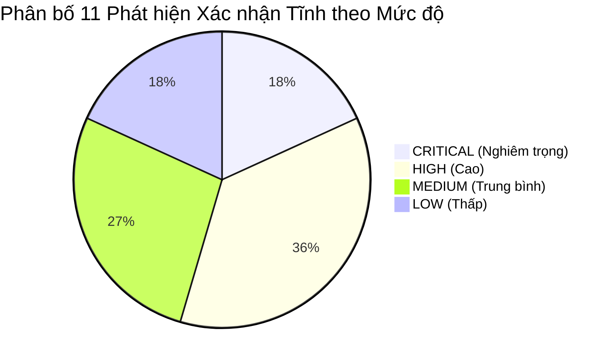

# Tổng hợp Kết quả Kiểm thử Tĩnh và Thẩm định An toàn Mã nguồn

## 1. Bảng Tổng hợp Số liệu Khảo sát Toàn diện

| Chỉ số | Giá trị định lượng | Ghi chú phương pháp / Phạm vi |
|---|:---:|---|
| **Tổng số tệp mã nguồn khảo sát** | **66 tệp PHP** | Toàn bộ mã nguồn PHP trong `librarian/` (loại trừ `vendors/` và bản sao). |
| **Tổng số dòng vật lý (Lines)** | **2,978 dòng** | Đo lường bằng kịch bản Python POSIX. |
| **Số dòng mã thực tế (SLOC)** | **2,551 dòng** | 85.7% dung lượng tệp (chú thích chiếm 0.9%, dòng trắng chiếm 13.4%). |
| **Số tiêu chí an toàn đã rà soát** | **25 tiêu chí** | Thuộc 7 nhóm an toàn trong `study/checklist.md`. |
| **Số tiêu chí Không đạt / Có rủi ro** | **19 tiêu chí** | 18 tiêu chí Không đạt + 1 tiêu chí Một phần (AUTH-04). |
| **Số tiêu chí Đạt chuẩn** | **1 tiêu chí** | AC-01: Giao diện quản trị có `include('session.php')`. |
| **Số tiêu chí Không áp dụng** | **1 tiêu chí** | INP-04: Tải tệp không được xử lý ở backend. |
| **Số tiêu chí Giả định / Thiếu đặc tả** | **4 tiêu chí** | AC-03 (RBAC), BIZ-01, BIZ-02, BIZ-04 (Ràng buộc mượn sách). |
| **Tổng số cảnh báo thô từ SAST** | **270 cảnh báo** | Quét tự động bằng Semgrep OSS 1.176.1 (100% parse rate). |
| **Số lỗi phát hiện bởi linter/type checker** | **17 lỗi** | PHPStan 2.1.8 phát hiện các include tệp bị gãy và lỗi định dạng. |
| **Số phát hiện được xác nhận tĩnh** | **11 phát hiện** | Gộp từ 270 cảnh báo thô và rà soát thủ công (`FIND-01` .. `FIND-11`). |
| **Số cảnh báo giả được bác bỏ** | **1 trường hợp** | `FP-01`: Cảnh báo gán nhầm tainted request vào khóa chính CSDL. |
| **Số mục chưa đủ bằng chứng nghiệp vụ** | **1 nhóm** | `BIZ-INC-01`: Các giả định nghiệp vụ mượn sách do thiếu SRS upstream. |
| **Tính tất định khi chạy lặp lại (Determinism)**| **100% (Độ lệch 0%)** | Xác nhận qua Run 1 vs Run 2 và kiểm tra checksum baseline. |

---

## 2. Phân bố Phát hiện Xác nhận Tĩnh theo Nhóm Mức độ và Danh mục CWE

| Mã phát hiện | Tên lỗ hổng / Thiếu sót | Danh mục CWE | Mức độ | Độ tin cậy | Trạng thái |
|---|---|---|:---:|:---:|:---:|
| **FIND-01** | SQL Injection tại Endpoint Đăng nhập (Auth Bypass) | CWE-89 | `CRITICAL` | `HIGH` | `confirmed-static` |
| **FIND-02** | Thiếu Kiểm soát Xác thực Phiên tại các Endpoint Hành động | CWE-306, CWE-284 | `CRITICAL` | `HIGH` | `confirmed-static` |
| **FIND-03** | SQL Injection Diện rộng tại các Chức năng CRUD và Tìm kiếm | CWE-89 | `HIGH` | `HIGH` | `confirmed-static` |
| **FIND-04** | Stored & Reflected Cross-Site Scripting (XSS) | CWE-79 | `HIGH` | `HIGH` | `confirmed-static` |
| **FIND-05** | Lưu trữ và Hiển thị Mật khẩu Dạng Bản rõ | CWE-256, CWE-312 | `HIGH` | `HIGH` | `confirmed-static` |
| **FIND-06** | Đổi trạng thái qua GET và Thiếu Cơ chế Chống CSRF | CWE-352 | `HIGH` | `HIGH` | `confirmed-static` |
| **FIND-07** | Race Condition và Thiếu Transaction trong Mượn Sách | CWE-362 | `MEDIUM` | `HIGH` | `confirmed-static` |
| **FIND-08** | Hardcoded Thông tin Kết nối CSDL trong `dbcon.php` | CWE-798 | `MEDIUM` | `HIGH` | `confirmed-static` |
| **FIND-09** | Sử dụng Thư viện CSDL Lỗi thời Đã Bị Xóa (`mysql_*`) | CWE-477 | `MEDIUM` | `HIGH` | `confirmed-static` |
| **FIND-10** | Lộ Cấu trúc CSDL qua Thông báo Lỗi `mysql_error()` | CWE-209 | `LOW` | `HIGH` | `confirmed-static` |
| **FIND-11** | Include Bị Gãy, Truy vấn Bảng Không Tồn tại và Tệp Rỗng | CWE-398, CWE-703 | `LOW` | `HIGH` | `confirmed-static` |

---

## 3. Danh mục các Mục Chưa đủ Bằng chứng và Giả định Nghiệp vụ (`inconclusive`)

1. **`BIZ-INC-01` (Ràng buộc Nghiệp vụ Mượn Sách Chưa có Đặc tả):**
   - *Biểu hiện:* `borrow_save.php` cho phép mượn sách mà không kiểm tra số lượng sách còn lại trong kho (`book_copies`), không giới hạn số lượng sách một độc giả được phép mượn, và không kiểm tra trạng thái thẻ độc giả (`member.status`).
   - *Căn cứ đánh giá:* Dự án upstream không cung cấp tài liệu đặc tả yêu cầu nghiệp vụ (SRS). Tuy logic mã nguồn thể hiện sự thiếu chặt chẽ, nhóm nghiên cứu tuân thủ nguyên tắc khách quan: **không tự ý kết luận đây là vi phạm yêu cầu phần mềm nếu không có đặc tả quy định trước**.
   - *Khuyến nghị:* Cần có sự xác nhận từ phía khách hàng / chủ sở hữu sản phẩm về quy định nghiệp vụ trước khi tiến hành bổ sung điều kiện kiểm tra.

---

## 4. Giới hạn của Nghiên cứu Kiểm thử Tĩnh

1. **Không thực thi và không khai thác động (Non-execution & No Exploitation):**
   - Kiểm thử tĩnh chỉ phân tích mã nguồn và luồng cú pháp/dòng dữ liệu trên lý thuyết. Nghiên cứu không thực hiện tấn công khai thác (PoC exploits) để tránh rủi ro phá hủy dữ liệu hoặc hiểu nhầm về mục đích kiểm thử.
2. **Phụ thuộc vào ngữ cảnh môi trường triển khai thực tế:**
   - Các yếu tố như cấu hình máy chủ Web (Apache `.htaccess`, Nginx rules), cấu hình PHP (`php.ini`, `magic_quotes_gpc`, `display_errors`), tường lửa ứng dụng web (WAF) có thể ảnh hưởng đến khả năng khai thác thực tế của các lỗ hổng như SQLi hay XSS nhưng không thể đo lường trực tiếp bằng kiểm thử tĩnh mã nguồn độc lập.
3. **Giới hạn phân tích liên tệp của công cụ SAST tự động:**
   - Công cụ tự động có xu hướng sinh cảnh báo giả (như trường hợp `FP-01`) khi luồng dữ liệu truyền qua các include hoặc câu truy vấn cơ sở dữ liệu gián tiếp, khẳng định vai trò không thể thay thế của việc rà soát thủ công có chuyên môn.
